<!-- ============================================ -->
<!--        LUCIDSC1PT - GITHUB PROFILE          -->
<!-- ============================================ -->

<div align="center">

<!-- Animated Header -->


Make or Modify something to make it good.

<!-- Typing Animation -->
<a href="https://git.io/typing-svg">
  
</a>

<!-- Profile Views + Followers -->


</div>

---

## 🌟 About Me

```yml
name: LucidSc1pt
location: Indonesia 🇮🇩
focus: Web Development, Automation, Open Source
motto: "Code with clarity, build with purpose."
hobbies:
  - Coding 💻
  - Learning 📚
  - Gaming 🎮
  - Coffee ☕
```

---

🛠️ Tech Stack

<div align="center">

💻 Languages


⚙️ Frameworks & Libraries


🗄️ Databases, Hosting & Tools


</div>

---

📊 GitHub Statistics

<div align="center">




<br/>


</div>

---

🏆 GitHub Trophies

<div align="center">
  
</div>

---

🌐 Connect With Me

<div align="center">

<a href="https://github.com/LucidSc1pt" target="_blank">
  
</a>

</div>

---

💭 Random Dev Quote

<div align="center">

</div>

---
<!--
☕ Support Me

<div align="center">

<a href="https://saweria.co/username" target="_blank">
  
</a>
<a href="https://ko-fi.com/username" target="_blank">
  
</a>

</div>

---
-->
<div align="center">

<!-- Animated Footer -->


✨ Thanks for visiting! ✨
</div>

<div align="center">

</div>
